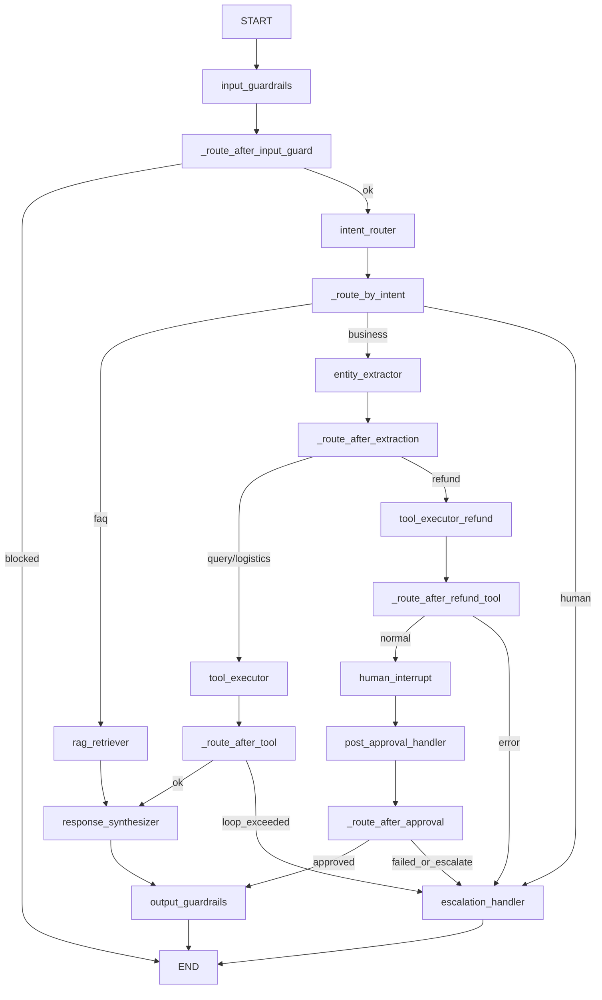

# AI Customer Assistant · 新人代码级架构指南

本指南不包含高空虚设的项目概念，而是直切**代码文件、类、函数、数据库列以及内存生命周期**，为您深度剖析整个智能客服系统的运行内幕。

---

## 1. 运行时上下文的核心：`AgentState`
系统各节点之间的数据流通和 LangGraph 的状态恢复，完全依赖于 [agent/state.py](file:///Users/zhangfeng/backend/AICustomerAssistant/agent/state.py) 中定义的 `AgentState` 类型（继承自 Python 的 `TypedDict`）。

由于底层的 `langgraph-checkpoint-postgres` 需要将状态以 JSONB 格式持久化到 Postgres 中的 `checkpoint_writes` 等表，`AgentState` 的各个属性被强约束为可 JSON 序列化的 Python 基础类型：

* **`messages`** (`Annotated[list[BaseMessage], add_messages]`): 
  - **作用**：全量聊天对话历史。
  - **实现**：采用 `add_messages` 作为 Reducer。每次节点返回 `{"messages": [new_msg]}` 时，LangGraph 会自动使用 append 逻辑追加到列表中，而不是粗暴地覆盖它。
* **`intent`** (`str | None`): 
  - **作用**：标识用户当前多轮交互的核心业务意图。
  - **取值**：`refund_request` (退款), `logistics_query` (物流), `order_query` (订单), `faq` (问答), `human_request` (转人工), `chat` (闲聊), 或在被拦截时标为 `blocked`。
* **`entities`** (`dict`): 
  - **作用**：结构化缓存槽位。
  - **细节**：例如 `{"order_id": "9821389421", "amount": 299.0, "refund_reason": "下错单了"}`。这些实体被提取并锁定，工具执行和审批都会直接读取此处的值。
* **`tool_outputs`** (`list[dict]`):
  - **作用**：缓存最近执行的数据库 SQL 真实返回详情。大模型正是根据该列表里缓存的明细来回答用户的。
* **`pending_approval`** (`dict | None`):
  - **作用**：缓存因需要人工审批而进入中断挂起时的审批单快照。
* **`escalation_reason`** (`str | None`):
  - **作用**：记录转人工的具体底层原因代码。

---

## 2. 状态机节点图编排 (LangGraph Node Topology)

状态机全套拓扑在 [agent/graph.py](file:///Users/zhangfeng/backend/AICustomerAssistant/agent/graph.py) 中构建并编译。在运行时，每次接收新消息，都会经历以下底层节点的函数逻辑：



---

## 3. 核心节点底层源码分析

### 3.1 输入安全校验：`input_guardrails`
* **源码位置**：[agent/guardrails/input_guard.py](file:///Users/zhangfeng/backend/AICustomerAssistant/agent/guardrails/input_guard.py)
* **核心逻辑**：
  1. 截取最新一条消息并做类型强制兼容：
     `raw_content = last_message.content; content = str(raw_content) if not isinstance(raw_content, str) else raw_content`。
  2. 匹配 `JAILBREAK_PATTERNS` 正则列表，检查是否试图注入或忽略设定（如“忽略你是一个客服的设定”）。一旦命中，节点强行返回 `{"intent": "blocked", "messages": [AIMessage(...)]}`，配合 `_route_after_input_guard` 路由直接将状态机引导至 `END` 退出，防止污染 LLM 上下文。
  3. 通过 `PHONE_PATTERN`、`ID_CARD_PATTERN` 正则检查敏感数据。由于用户指定了“不脱敏”以配合下游业务，因此此处仅记录脱敏审计日志，不在运行时修改 content。

### 3.2 意图路由与条件分流：`intent_router`
* **源码位置**：[agent/nodes/intent_router.py](file:///Users/zhangfeng/backend/AICustomerAssistant/agent/nodes/intent_router.py)
* **核心逻辑**：
  - 构建 Prompt 让大模型进行意图五分类（`order_query`、`logistics_query`、`refund_request`、`faq`、`human_request`），温控设为 `0.0` 确保确定性，输出 `response_format={"type": "json_object"}`。
  - 通过 `_route_by_intent` 条件路由分支：`faq` 意图流向知识检索 `rag_retriever`；订单/物流/退款意图流向实体锁定 `entity_extractor`；转人工意图直接流向 `escalation_handler`。

### 3.3 显式实体抽取：`entity_extractor`
* **源码位置**：[agent/nodes/entity_extractor.py](file:///Users/zhangfeng/backend/AICustomerAssistant/agent/nodes/entity_extractor.py)
* **核心逻辑**：
  - 许多工具需要主键字段（如退款需要 order_id 与 amount，物流需要 tracking_number）。
  - 大模型在此节点专门抓取用户提到的纯参数，滤除所有 null 和空字符串后合入 `state.entities`。
  - **重要性**：避免了大模型在闲聊中产生幻觉、或盲目调用数据库导致抛出 SQL 参数解包报错。

### 3.4 动态工具调用与防崩溃机制：`tool_executor`
* **源码位置**：[agent/nodes/tool_executor.py](file:///Users/zhangfeng/backend/AICustomerAssistant/agent/nodes/tool_executor.py)
* **核心逻辑**：
  1. 通过 `INTENT_TOOL_MAP` 获取当前意图绑定的 LangChain 工具（如 `submit_refund`）。
  2. **内省校验 (Signature Introspection)**：
     ```python
     underlying_func = getattr(tool_func, "func", None) or getattr(tool_func, "coroutine", None) or tool_func
     sig = inspect.signature(underlying_func)
     ```
     如果工具需要的参数（无默认值）未在 `state.entities` 中出现，代码将不予执行，并直接抛出 `BusinessRejectionError`，返回带 `tool_error` 槽位错误信息的 state。合成节点捕获此信息后，能够像人类一样礼貌地向用户追问：“请问您的订单号是多少？”
  3. **连接池重试机制**：使用 `tenacity` 捕获 `RetryableToolError` 进行 3 次指数退避重试，全败后触发 `escalation_reason` 降级转人工。
  4. **执行结果闭环**：工具运行成功后，将返回值格式化存入 `state.tool_outputs` 并回填关键主键。

### 3.5 人工审批中断：`human_interrupt`
* **源码位置**：[agent/nodes/human_interrupt.py](file:///Users/zhangfeng/backend/AICustomerAssistant/agent/nodes/human_interrupt.py)
* **核心逻辑**：
  - 退款申请在确认后，生成包含 `refund_id` 和随机 `idempotency_key` 的临时结构体。
  - 调用 **LangGraph 核心 `interrupt()` 函数**：
    `approval_result = interrupt(approval_request)`
  - **运行时表现**：此时整个程序会被挂起，并在 PostgreSQL 中落盘当前的 session 堆栈和快照，等待外界通过 REST API 传入审批结果信号。

### 3.6 审批后处理与 Saga 分布式事务：`post_approval_handler`
* **源码位置**：[agent/nodes/post_approval_handler.py](file:///Users/zhangfeng/backend/AICustomerAssistant/agent/nodes/post_approval_handler.py)
* **核心逻辑**：
  - 审批信号通过 `Command(resume=...)` 唤醒状态机后，从 `state.pending_approval` 读取审批结果。
  - **Saga 三阶段事务提交**：
    1. **Pre-check**：验证 MySQL 订单信息（防并发改价）。
    2. **Local-lock**：在 PG `pending_refunds` 表中标记状态为 `approved`。
    3. **Notify-business**：推送退款请求到业务系统消息队列（传入 `idempotency_key`）。
  - 若其中任何一步由于网络或数据库断开抛出异常，`except` 块会捕获异常，阻断打款动作，并将状态改为人工处理，防止资金损失。

---

## 4. 双数据库物理隔离配置 (`connections.py`)

系统在 [db/connections.py](file:///Users/zhangfeng/backend/AICustomerAssistant/db/connections.py) 中通过 SQLAlchemy 2.0 异步驱动分别创建了两个物理引擎：

* **PostgreSQL Engine (`pg_engine`)**：
  - **映射模型**：[db/pg_models.py](file:///Users/zhangfeng/backend/AICustomerAssistant/db/pg_models.py)。
  - **参数优化**：设置 `jit="off"` 优化小查询启动时效，强加 `statement_timeout="30000"` (30秒) 守护。
* **MySQL Engine (`mysql_engine`)**：
  - **映射模型**：[db/mysql_models.py](file:///Users/zhangfeng/backend/AICustomerAssistant/db/mysql_models.py)。
  - **只读性质**：仅映射 `Order`, `Product`, `User`, `Payment` 进行只读查询，保护业务核心数据。

### 4.1 UUID 的安全降维处理
Postgres 物理表结构对外键和主键应用了 strict UUID。但在 API 和测试框架中，`tenant_id` 是 `"t-001"`，`session_id` 是 `"eval-TC-001-xxxx"`。
为防止 PostgreSQL 驱动在插入 `PendingRefund` 记录时抛出 UUID 格式转换异常，我们在 `submit_refund` 工具中执行了确定性转换逻辑：
```python
import uuid
try:
    tenant_uuid = uuid.UUID(str(raw_tenant))
except ValueError:
    tenant_uuid = uuid.uuid5(uuid.NAMESPACE_DNS, str(raw_tenant))
```
通过 `uuid.uuid5`，可将任何非常规字符串在内存中计算出符合 UUID 标准的 128 位哈希映射，彻底消除了物理主外键的格式冲突。

---

## 5. API 路由层设计 (FastAPI Routes)

系统的外部接口位于 `api/routes/` 下：

### 5.1 用户聊天路由 ([chat.py](file:///Users/zhangfeng/backend/AICustomerAssistant/api/routes/chat.py))
* **`/send` (POST)**：
  - 用于单次同步发送。初始化 `AgentState` 并为 `tool_outputs` 分配空列表，调用 `agent_graph.ainvoke(...)` 时显式指定其配置为包含 `thread_id` 的 `RunnableConfig` 类型。运行完毕后将最后一条消息发布到 Redis `session:{session_id}` 通道中。
* **`/stream` (GET)**：
  - SSE 流式推送通道，利用 `redis_client.pubsub()` 订阅会话事件，流式回传大模型实时生成的数据块。

### 5.2 后台审批路由 ([admin.py](file:///Users/zhangfeng/backend/AICustomerAssistant/api/routes/admin.py))
* **`/approve/{refund_id}` (POST)**：
  - 标记 `PendingRefund` 状态为 `RefundStatus.APPROVED` 并记录 `reviewed_by`。
  - **重要调用**：使用 `Command` 传入 `resume_payload` 并恢复状态机：
    `await agent_graph.ainvoke(Command(resume=resume_payload), config=config)`。
  - 通过 Redis 通道广播 `event="approved"` 通知前端刷新。

---

## 6. 类型安全与单元测试规程

在开发新的业务工具或状态机节点时，可以通过以下两个测试保障系统完整性：

1. **类型错误扫描**：
   ```bash
   /opt/anaconda3/envs/ai-customer-assistant/bin/mypy --ignore-missing-imports agent/ config/ db/ api/ services/
   ```
   *确保输出始终为 `Success: no issues found`，避免变量在运行时由于 implicit Optional 或 Union 引起的 AttributeError。*

2. **状态回归测试**：
   ```bash
   /opt/anaconda3/envs/ai-customer-assistant/bin/python -m pytest tests/
   ```
   *E2E 测试用例 `test_eval_runner.py` 在运行结束后，会在 `finally` 阶段触发 `await dispose_engines()` 重置全局引擎连接池，防止连接泄露和 Event Loop closed 报错。*
